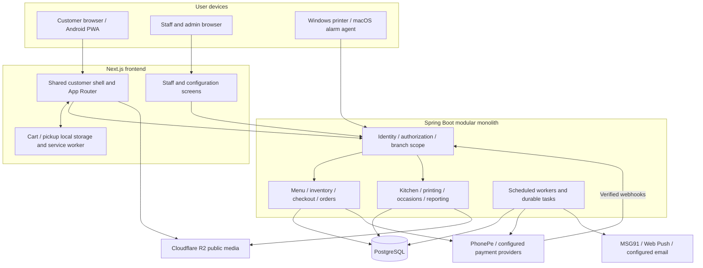
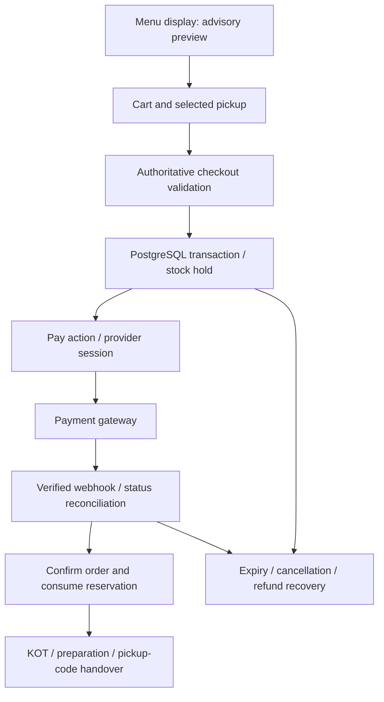
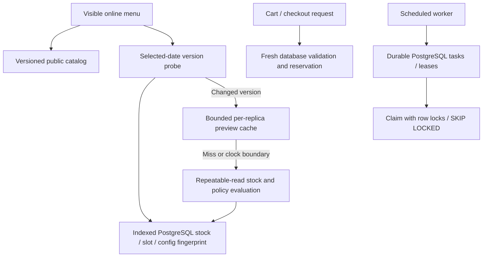

# Gokul Sweets application architecture

Reviewed 23 October 2026 against DEV `b02f537` (the source promoted in PR #231). This is a source-code map, not an audit of live hosting settings, secrets, database size or production telemetry. PostgreSQL provider and effective production feature flags require deployment evidence. Repository deployment documentation describes Vercel frontend and a Render Docker backend; the database is selected by `DATABASE_URL`.

## System and trust boundaries

The diagrams group modules for readability: these are not separate deployed microservices. Browser storage holds convenience state, not stock ownership or proof of payment. Staff/admin and native agents use authenticated backend routes. Public R2 media is separate from transactional data.

## Application modules

| Area | Responsibilities / entry points |
| --- | --- |
| Customer experience | Branch discovery, menu/category/portion browsing, campaigns, reviews, account, badges, notifications, PWA installation and consent |
| Catalog and merchandising | Products, branch products, dietary data, category order, service windows, menu imports, homepage campaigns and menu appearance |
| Ordering | Pickup discovery, dated item checks, real cart quantities, tax/fees, offer exclusions, rewards, reservation, normal and future orders |
| Inventory | Dated allocation, ready quantity, holds, expiry, preparation policies, automation, durable inventory-centre jobs |
| Payments | PhonePe creation/redirect/status/webhooks, pending attempt recovery, expiry and refund reconciliation; configured legacy provider integrations |
| Fulfilment | Staff plan/prepare/handover, pickup code validation, KOT/print delivery, native printer and alarm agents |
| Other business modules | Occasion requests/approvals/installments, delivery/rider holds, customer corrections, reporting and cleanup |
| Cross-cutting | Staff roles and branch scope, customer identity, environment separation, storage, scheduled work, Java method timing and diagnostics |

## Stock and payment authority

Menu Add eligibility is advisory. A successful display check does not reserve the last unit. Payment success is determined by the backend, not a browser redirect. Provider interactions, reservations and cancellation/reconciliation must retain idempotency and database concurrency protections. Keep the existing financial and reservation schedulers enabled in production.

## Read and background-work paths

- Catalog uses revision-addressed data. Current service status also depends on time.
- Opt-in dated previews use stock/slot UUID tokens plus configuration revision and exact branch/date/item quantities. Cache bounds: 64 entries and 20,000 item/issue units. Time boundaries and a five-minute ceiling expire previews. A miss uses a repeatable-read snapshot; publication follows successful commit.
- Visible menu version probes run approximately two seconds after the previous probe completes. A one-second per-replica hint cache shares database reads. Hidden/offline pages pause checks; failures back off. Stock invalidations coalesce during an active preview; context changes cancel obsolete work.
- `GOKUL_MENU_VERSIONED_PREVIEWS_ENABLED` is OFF by default. Source capability does not establish that production has enabled it.
- Customer bell and sound runtime share a 30-second polling timer. Inbox summary reads omit full message bodies; private API responses remain uncached.
- Inventory-centre empty polling backs off, and a local committed submission wakes the local worker. Other replicas discover work via polling and database leases. Payment, reservation, notification and reporting schedules remain separate work.

## Improvement opportunities, ordered by practical value

| Priority | Evidence in current source | Proposed next change | Validation before rollout |
| --- | --- | --- | --- |
| High | Snapshot shows repeated menu/availability requests but no recording duration; cache feature defaults OFF | Confirm effective cache flag and V137 in DEV/PROD. Record a five-minute trace for active, background, offline and unchanged stock states, with server query counts | Measure request counts, payload, DB statements, p50/p95 preview latency and active DB time; confirm Add reacts to ready quantity, reservations and time boundaries |
| High | Browser probes every ~2 seconds; fingerprint still touches PostgreSQL and hints are local to each replica | If measurement warrants it, introduce branch/date invalidation delivery using an authenticated SSE endpoint and a durable/shared change source. Treat events as refresh hints; retain reconnect and periodic fallback | Cross-replica writes, dropped/duplicated events, direct SQL changes, branch switches, proxy disconnects and sleeping backend recovery. Never trust event payload as a reservation |
| High | API and many `@Scheduled` jobs share the application deployment; scheduling pool is one thread | Measure job runtimes/lag and split API and durable workers when contention appears. Introduce separate worker-role settings and bounded concurrency instead of disabling all schedules | Preserve payment/hold/refund deadlines, database leases and exactly-once effects under duplicate execution. Observe queue age, oldest pending refund and expired-hold lag |
| High | `frontend/public/sw.js` image cache uses cache-first and `cache.put` without an explicit count/age bound | Bound media cache entries/bytes or age and use versioned asset URLs for replacements; retain safe offline navigation and uncached transactional routes | Upgrade existing PWA, replace same-URL images, offline revisit, storage quota failure and private page behaviour |
| Medium | Public appearance, offers, branch metadata and portion groups still have independent reads | Add explicit revision/visibility contracts and conditional responses for public configuration, with schedule-boundary expiry | Scheduled publication/unpublication, branch closure, invalidation across replicas and rolling deployment |
| Medium | Menu presentation spans many sequential global CSS layers and repeated selectors | Gradually consolidate menu layout ownership into scoped components/tokens, with screenshot regressions at 320/390/640/1280px | Flags OFF, Hindi/long copy, keyboard focus, reduced motion, sticky header and cart dock; avoid a wholesale visual rewrite |
| Medium | CI has intermittently timed out in a stalled-payment browser scenario that passed unchanged local repeats and rerun | Add request-start synchronization, trace/console/state capture on failure, and measure actual recovery deadlines under a busy runner | Keep all payment safety assertions; do not hide failures with blanket retries or remove the negative scenario |
| Medium | Cleanup is bounded and defaults to 90-day retention; operational and financial tables have different requirements | Review per-table growth and configurable retention with archive/export requirements; keep financial/idempotency evidence separate from transient notification attempts | Preview counts, FK ordering, audit evidence, restore exercise and query plans at projected order volume |

### Architectural direction

Keep the modular monolith and PostgreSQL transactional boundary for this scale. Microservices, a second transactional database or Redis would add operating complexity before evidence establishes a need. Prioritize measured read reduction, explicit configuration revisions, worker isolation and bounded client caches. Event-driven display refresh can improve freshness and request volume later, but it must not replace authoritative checkout validation.

Do not assume JSONB inherently reduces database storage: payload size, compression, TOAST behaviour, indexes and query patterns determine the result. Do not discard notification delivery/idempotency records that are needed for deduplication or safe retry merely to reduce row counts.

## Source evidence

- `frontend/components/layout/AppShell.tsx`, `frontend/app`, `frontend/public/sw.js`
- `frontend/services/menuApi.ts`, `availabilityApi.ts`, `menuStateWatch.ts`, `customerNotificationPolling.ts`
- `backend/src/main/java/com/gokulsweets/restaurant/order/service/VersionedMenuPreview.java`, `MenuInventoryVersion.java`
- `backend/src/main/resources/db/migration/V136__reporting_update_index.sql`, `V137__menu_inventory_versions.sql`
- `backend/src/main/java/com/gokulsweets/restaurant/inventory/centre/InventoryCentreWorker.java`
- `backend/src/main/java/com/gokulsweets/restaurant/payment/service`, `order/lifecycle/scheduler`, `customer/notification`, `staff/notification`
- `backend/src/main/resources/application.properties`, `backend/Dockerfile`, `vercel.json`
- `docs/operations/database-usage.md`, `docs/manual-vercel-deployment.md`

## What this change implements

The menu presentation change groups pickup warnings into a compact status card, avoids repeating the expired-selection warning, clarifies the pickup action, gives category photos a consistent circular treatment and reduces the mobile campaign height while preserving the published Diwali media, copy, crop and category destinations. Data, pricing, stock checks, cart/pickup persistence, checkout and the architecture opportunities above are not changed by this presentation work.

### Presentation validation

Local production build, TypeScript, ESLint and all 252 frontend unit tests pass. Existing browser regressions pass for compact pickup headers (including keyboard focus/scroll restoration), Diwali campaigns and category actions, soonest pickup, expired times, stale replies and cart preservation. New layout checks cover 320/390/640px, 1280px and feature flags OFF, ensure warnings remain visible, prevent horizontal overflow and verify white pickup-action text. Test fixtures use representative food artwork; production media remains admin-managed.

- [Expired pickup / no available time, 390px](../qa/menu-presentation/mobile-expired.png)
- [Selected pickup, 390px](../qa/menu-presentation/mobile-selected.png)

Full PR CI is pending. No production changes or live stock mutations have been performed.
